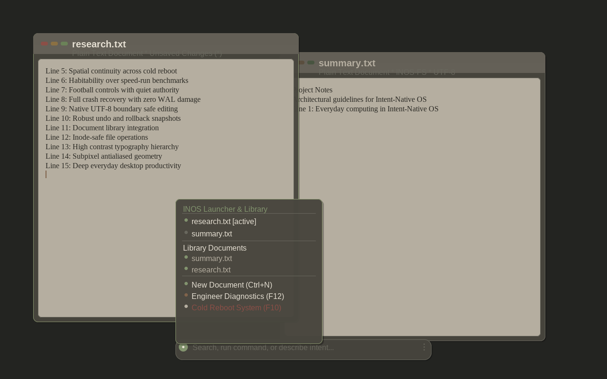
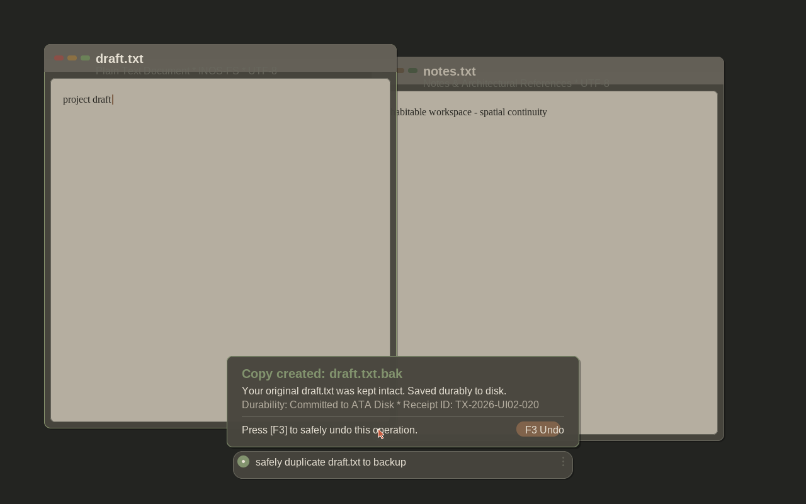

# Intent-Native Operating System (INOS)

An experimental x86-64 operating system exploring typed intent contracts, capability-enforced Ring 0 / Ring 3 isolation, and local quantized model mediation without Python or cloud runtime dependencies.

Developed at [Driftbound Labs](https://driftboundlabs.com).

---

## QEMU GOP Framebuffer Captures (`1280×800`)

| Spatial Desktop & Document Launcher | Atomic WAL Mutation Receipt (`F3 Undo`) |
|---|---|
|  |  |

---

## Architecture Overview

| Layer | Implementation | Scope |
|---|---|---|
| **Kernel (`kernel/`)** | Rust (`no_std`, x86-64 UEFI) | Physical frame allocator, `W^X` 4-level paging, per-process `CR3` Ring 0/3 isolation, capability table enforcement, atomic WAL filesystem (verified across 6 crash-injection boundaries), VirtIO-Blk/ATA, VirtIO-Net TCP/UDP, stateful firewall, RFC 4035 DNSSEC validation, ChaCha20 hardware CSPRNG, and 1280×800 GOP desktop compositor. |
| **Userspace & Desktop Suite (`userspace/`)** | Rust (`no_std` Ring 3) + freestanding OCaml/C | `sdk/`, `user_init/`, `user_intent_runtime/`, and 17 native Ring 3 applications (`write`, `grid`, `canvas`, `pdf`, `mail`, `notes`, `plan`, `files`, `archive`, `calc`, `flow`, `intscript`, `script`, `spin`, `net`, `web_render`, `security_console`). |
| **Intent Control Plane (`core/`, `compiler/`)** | OCaml 5 | Typed Intent IR, deterministic DAG validator, capability binding, clarification state machine, staged execution with differential verification, dual-model A/B handoff & arbitration, and append-only audit receipts. |
| **Local Inference (`models/`)** | C (AVX2/FMA) + OCaml | Freestanding `Q8_0` / `Q4_0` quantized forward pass (`quant_engine.c`), BPE tokenizer, LoRA adapter hub, and optional TinyStories-15M Llama-2 baseline runner (`scripts/fetch_models.sh`). |
| **Security & Update (`security/`)** | OCaml + C | Fail-closed capability broker, CTAP2/FIDO2 authenticator protocol, NIST FIPS 203 (`ML-KEM-768`) & FIPS 204 (`ML-DSA-65`) post-quantum primitives, TUF v1.0.33 signed repository metadata, and BIP-39 recovery shards. |
| **Quarantined Research Modules (`research/`)** | OCaml (`OFF` by default) | Experimental `scp`, `tonic`, and `nnc` modules preserved with their benchmark records (`docs/research/L308_DECISION_RECORD.md`). |

---

## Claim Boundaries & Current Status (`v0.3-alpha`)

Per Driftbound Labs engineering rules, what this system **has not** verified is stated alongside what it has:

1. **Reference Hardware Target:** Boot, storage crash recovery, networking, Ring 3 isolation, and graphical compositor workflows are verified under **QEMU/OVMF (`x86_64`)**. Broad bare-metal laptop/workstation PCIe, Wi-Fi, and GPU driver support is **not** implemented.
2. **Beta Authorization Withheld (`docs/security/sentinel/BETA_READINESS_REPORT.md`):** Automated Sentinel BQS qualification suites pass in emulation, but production Beta status remains explicitly withheld behind two open gates:
   - `BLK-01`: Physical USB HID FIDO2 hardware-token passthrough test on bare metal (emulated CTAP2 transport only in QEMU).
   - `BLK-02`: Independent external third-party cryptographic and kernel memory-safety audit.
3. **Quarantined Research Lanes (`docs/research/L308_DECISION_RECORD.md`):** Both `research/tonic` (failed its L306 model-invocation reduction target: `71` invocations vs. `40` in control `C00`) and `research/scp` (`0.0%` false-authorization rate matching the existing deterministic AST verifier) are compiled **off by default**.

---

## Quick Verification (OCaml Control Plane & 55 Test Suites)

Requires OCaml `>= 4.14`, `dune >= 3.0`, and a C compiler (`gcc` / `clang` with AVX2 support):

```bash
# 1. Verify monorepo structural invariants (Gate G0)
dune exec scripts/verify_repo.exe

# 2. Build all OCaml + C control-plane, security, and verification targets
dune build @all

# 3. Run all 55 unit, property, adversarial-boundary, and Sentinel BQS suites
dune runtest

# Optional: download the 60.8 MB MIT-licensed TinyStories-15M weights to enable live Llama-2 weight tests
./scripts/fetch_models.sh
dune runtest
```

To build the bare-metal Rust x86-64 UEFI kernel and launch the QEMU desktop image (requires nightly Rust `x86_64-unknown-uefi` / `x86_64-unknown-none` + `qemu-system-x86_64`):

```bash
./scripts/build_kernel.sh
```

---

## Documentation Index

- [`ARCHITECTURE_DECISIONS_AND_NON_GOALS.md`](ARCHITECTURE_DECISIONS_AND_NON_GOALS.md) — Core architectural constraints (including ADR-0001 zero-Python runtime rule and non-goals).
- [`intent_native_os_engineering_spec_v0_2.md`](intent_native_os_engineering_spec_v0_2.md) — Full systems specification and invariants (`I-01`–`I-10`).
- [`docs/security/sentinel/BETA_READINESS_REPORT.md`](docs/security/sentinel/BETA_READINESS_REPORT.md) — Security gate audit and open hardware/audit blockers.
- [`docs/research/L308_DECISION_RECORD.md`](docs/research/L308_DECISION_RECORD.md) — Empirical evaluation and quarantine decision for experimental research lanes.

---

## License

Apache License 2.0 — see [`LICENSE`](LICENSE) and [`NOTICE`](NOTICE).
