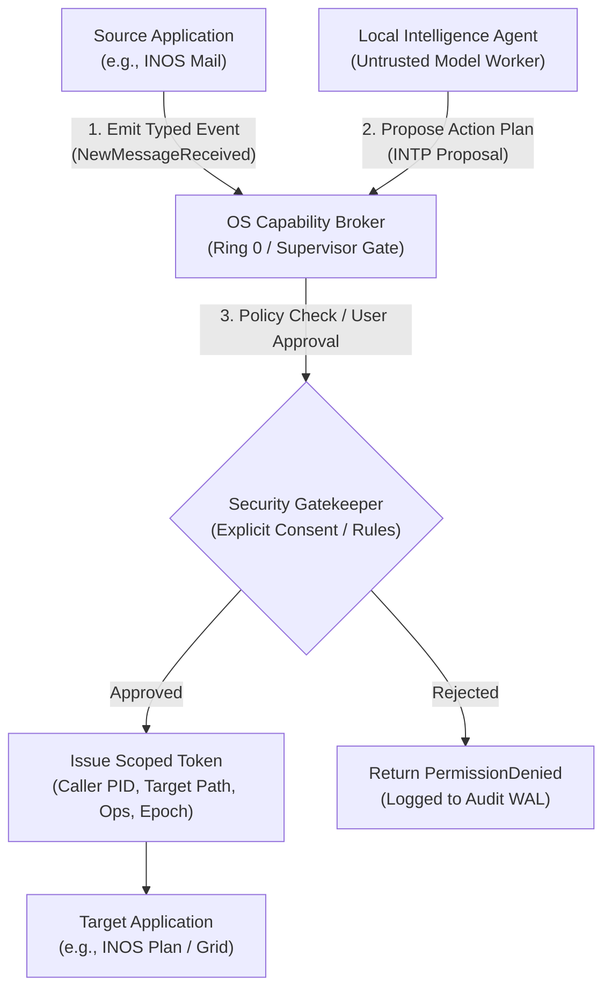

# Cross-Application Integration Contracts & Capability Broker (APF-001)

**Document Identifier:** `APF-001-INTEGRATION-CONTRACTS`  
**Security Model:** Object-Capability (C-List), Ephemeral Token Granting, Kernel-Enforced Boundaries

---

## 1. Architectural Foundations of the Capability Broker

All communication and data sharing between INOS native applications, background services, and local intelligence agents take place across typed capability interfaces managed by the trusted OS Capability Broker (`inos-broker`).



### Invariant Rules
1. **No Direct Ambient Authority:** No application has ambient access to the filesystem, network, or other process address spaces.
2. **Untrusted Agent Proposals:** Local language models generate proposals (`INTP` format), never authorizations. An agent proposal cannot execute without passing through policy evaluation and, where required by policy, explicit user authorization.
3. **Reversible Action Receipts:** All capability-mediated modifications log forward operations and compensatory rollback operations into the system transaction journal.

---

## 2. Core Typed Application IPC Protocols

### 2.1 Capability Token Schema (`CapToken`)
```rust
#[repr(C)]
pub struct CapToken {
    pub caller_pid: u64,
    pub target_resource_hash: [u8; 32], // Canonical path or object hash
    pub allowed_operations: u32,       // READ=1, WRITE=2, CREATE=4, DELETE=8, EXEC=16
    pub epoch: u32,                    // System capability epoch (invalidated on revocation)
    pub expiry_timestamp: u64,         // Absolute RTC timestamp
    pub signature: [u8; 32],           // Kernel HMAC-SHA256 over token fields
}
```

### 2.2 Intent Proposal Protocol (`INTP`)
```rust
pub enum AppIntentProposal {
    ScheduleEvent {
        title: [u8; 64],
        start_time: u64,
        end_time: u64,
        location: [u8; 64],
        participants: [[u8; 64]; 4],
        provenance_message_id: [u8; 32],
    },
    ImportTableToGrid {
        source_attachment_path: [u8; 128],
        target_sheet_name: [u8; 32],
        delimiter: u8,
        destination_cell: [u8; 8],
    },
    GenerateDocumentReport {
        title: [u8; 64],
        grid_data_range: [u8; 32],
        summary_text: [u8; 512],
        target_format: u32, // 1 = DOCX, 2 = PDF
    },
}
```

---

## 3. High-Priority Cross-Application Workflow Contracts

### Workflow 1: Mail → Plan (Meeting Detection & Scheduling)
- **Trigger:** Incoming email parsed by INOS Mail containing scheduling semantics.
- **Contract:**
  1. Mail extracts candidate event details into an unprivileged `ScheduleEvent` proposal.
  2. Local Intent runtime verifies calendar availability via read-only capability query to INOS Plan.
  3. If availability exists, the system presents an interactive inline card in the notification drawer: *"Schedule 'Quarterly Review' on Tuesday 2:00 PM?"*
  4. Upon user confirmation (or pre-authorized calendar policy), the Capability Broker issues a scoped token granting `CREATE_EVENT` to INOS Plan.
  5. INOS Plan commits the event to RFC 5545 storage and arms a local notification alarm.

### Workflow 2: Mail → Files → Grid (Attachment Ingestion & Analysis)
- **Trigger:** Email received with tabular attachment (`.csv`, `.xlsx`).
- **Contract:**
  1. User or automated rule initiates attachment ingestion.
  2. Capability Broker issues a temporary read token for the isolated attachment cache in Mail storage.
  3. INOS Files stages the file into the user's workspace directory with WAL durability.
  4. INOS Grid is invoked with a scoped read token to parse and populate a spreadsheet session, immediately running DAG dependency recalculation.

### Workflow 3: Grid → Write → PDF (Report Generation & Publishing)
- **Trigger:** User requests export of verified financial/analytical figures into a formatted report.
- **Contract:**
  1. INOS Grid exports computed cell values and chart metadata into an immutable IPC shared memory buffer.
  2. INOS Write receives the buffer under a read-only capability, embedding the table into the document template with matching typographic styles.
  3. INOS Write passes the formatted page stream to the INOS PDF engine.
  4. The PDF engine renders vector graphics, fonts, and linearized document tables, saving the final signed PDF to disk.

### Workflow 4: Plan → Notifications (Durable Local Alarms)
- **Trigger:** Event scheduled in INOS Plan reaching its reminder threshold.
- **Contract:**
  1. INOS Plan registers an alarm with the kernel timer / RTC subsystem.
  2. The notification daemon triggers an audio-visual desktop alert and stores the notification in the durable event ledger.
  3. When an authenticated companion phone bridge is configured, the notification is encrypted and signed before dispatch.

### Workflow 5: Files → Intent (Semantic Search & Safe Action Composition)
- **Trigger:** User queries the Intent Bar: *"Find the invoice from Acme Corp last month and summarize expenses."*
- **Contract:**
  1. Intent Bar queries the local file index under user-scoped read permissions.
  2. Documents matching the query are inspected; relevant text spans are extracted using deterministic search or local model embeddings.
  3. Summary results are composed into a read-only preview card with clickable source document links.
  4. No files are moved, copied, or deleted without explicit secondary user confirmation.
