# INOS Autonomous Product Foundry: Master Engineering Plan (APF-001)

**Mission:** Complete the INOS native application suite and build an exceptionally efficient, fully local intelligence runtime capable of coordinating those applications under strict zero-trust isolation and capability security.

**Execution Model:** Autonomous multi-agent engineering program with persistent task management, independent verification gates, reproducible builds, and continuous integration.

**Authority Principle:** The user defines the product vision, boundary invariants, and release constraints. The autonomous engineering organization determines implementation details, runs experiments, benchmarks competing architectures, fixes regressions, and advances across gates without requiring routine approval.

---

## 1. Program Invariants & Boundary Conditions

1. **Zero Python:** Strict zero Python across the INOS codebase, userland applications, SDK, build system, runtime, test harnesses, and CI. Build uses freestanding Rust, OCaml 5, Dune, C/C++ (for inference kernels where strictly justified), and POSIX Bash.
2. **Architecture Preservation:** Dual-stack Rust (kernel, drivers, low-level security, and high-performance Ring 3 application engines) and OCaml (intent compiler, semantic verification, type checking, and deterministic planner).
3. **Local Inference by Default:** 100% offline-capable local intelligence. Zero cloud or remote inference dependencies.
4. **Model Unprivileged & Untrusted:** Models cannot authorize actions, grant capabilities, or elevate permissions. Model outputs are strictly untrusted proposals passed through the typed capability broker.
5. **Functional Autonomy:** All core native application functionality (viewing, editing, formula recalculation, file operations, drawing, local scheduling) must operate completely and deterministically when local inference is disabled or unloaded.
6. **Isolated Development Worktree:** Dedicated development branch `foundry/apf-001` in isolated worktree `IntentNativeOS` to prevent conflicts with concurrent OS kernel and Browser development sessions.
7. **QEMU-Only Execution:** All virtualization and hardware tests execute exclusively in isolated QEMU environments with synthetic firmware variables and virtual disk images. Host disks, physical partitions, EFI variables, and host security policies are never modified.

---

## 2. Autonomous Team Organization & Operational Roles

| Role | Key Mandate | Primary Deliverables |
| :--- | :--- | :--- |
| **Autonomous Engineering Supervisor** | Backlog ownership, priority scheduling, dependency graphing, worker dispatch, failure recovery, regression auditing. | Execution queue, health checks, rollback management, milestone promotions. |
| **Application Engineering Team** | Native Ring 3 applications, user interaction models, persistence engines, format parsers/encoders. | Files+Archive, Grid, Write, PDF, Canvas, Mail, Plan, Intent, System Utilities. |
| **Local Model Research Team** | Quantized inference kernels, context efficiency, KV cache management, LoRA orchestration, dual-model protocol. | Qwen integration, GGUF/C backend, LoRA swapping, semantic context compression (SCP), tonic gating (TG). |
| **Computational Systems Team** | Network-Native Computing (NNC), incremental execution graphs, dependency-aware memoization, CPU/GPU scheduling. | Merkle state tracking, sparse change recalculation, cache invalidation proofs, resource throttling. |
| **Integration & QA Team** | Fuzzing, negative security suites, crash injection, interoperability round-trips, regression baselines. | Automated harnesses (`scripts/test_*.sh`), cold-reboot proofs, crash recovery verification. |
| **Independent Verification Gate** | Cryptographic audit, format conformance, memory leak verification, capability confinement proof. | Release gating reports, independent acceptance evidence, compliance certification. |

---

## 3. Phased Delivery Roadmap

```mermaid
flowchart TD
    subgraph Phase1["Phase 1: Foundation & Baseline Freeze"]
        P1A["Worktree & Toolchain Validation"]
        P1B["Engineering Ledger & Task Graph"]
        P1C["Baseline Regression Certification"]
    end

    subgraph Phase2["Phase 2: Core Native Productivity Suite"]
        P2A["Files + Archive Engine (RFC 1951 / ZIP)"]
        P2B["Grid Spreadsheet Engine (DAG / CSV / XLSX)"]
        P2C["Write Word Processor (Rich Text / DOCX / Layout)"]
        P2D["PDF Document Engine (Rendering / Vector / Forms)"]
        P2E["Canvas Creative Suite (Layers / Raster / Geometry)"]
        P2F["Mail & Messaging Client (Mbox / MIME / IMAP / SMTP)"]
        P2G["Plan Calendar & Tasks (iCal / Conflict / Reminders)"]
    end

    subgraph Phase3["Phase 3: Local Intelligence & Optimization"]
        P3A["Freestanding C/Rust Quantized Inference Kernel"]
        P3B["Dual-Model Protocol (Model A Reviewer / Model B Implementer)"]
        P3C["Dynamic LoRA Swapping & Context Pruning"]
        P3D["SCP / TG Empirical Evaluation"]
        P3E["Network-Native Computing (NNC) Substrate"]
    end

    subgraph Phase4["Phase 4: Cross-Application Orchestration"]
        P4A["Capability Broker & Intent IPC"]
        P4B["Typed Cross-App Workflows (Mail->Plan, Mail->Files->Grid, Grid->Write->PDF)"]
        P4C["Reversible Action Ledger & Rollback Receipts"]
    end

    subgraph Phase5["Phase 5: Hardening & Independent Release Gate"]
        P5A["Negative Security & Fuzzing Matrix"]
        P5B["Cold-Reboot Persistence & Crash Durability"]
        P5C["Integrated Productivity Demonstration"]
    end

    Phase1 --> Phase2
    Phase2 --> Phase3
    Phase3 --> Phase4
    Phase4 --> Phase5
```

---

## 4. Execution Loop & Continuation Protocol

1. **Task Selection:** Supervisor picks highest-priority unblocked item from `docs/APF-001-STATUS.md`.
2. **Inspection & Test Definition:** Inspect existing interfaces, write failing regression / acceptance tests before making changes.
3. **Implementation:** Freestanding, memory-safe implementation adhering to zero-Python and no-std invariants.
4. **Verification:** Execute automated test harnesses, verifying both positive functionality and negative security bounds.
5. **Cold Reboot Durability:** Verify filesystem mutations survive complete QEMU shutdown and reboot.
6. **Commit & Ledger Update:** Atomic commit with structured commit message referencing APF ticket; update status ledger and decision log.
7. **Promotion / Recovery:** Advance to next task if successful; autonomously select alternative algorithmic approach if benchmarked criteria fail.
