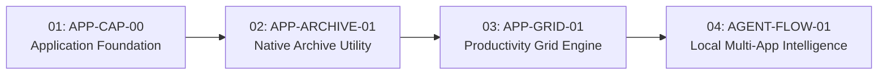

# INOS Native Application Foundry & Local Agentic Runtime — Master Implementation Specification (INOS-APP-CAP-001)

**Document Identifier**: `INOS-APP-CAP-001`  
**Version**: 1.0  
**Classification**: Implementation-Ready Backlog  
**Target Architecture**: x86_64 Long Mode (QEMU OVMF UEFI)  
**Security Model**: Capability-Addressed, Model-Free Deterministic Verification, Zero-Trust Ring 3

---

## 1. Executive Summary & Program Objectives

The goal of the **INOS Native Application Foundry & Local Agentic Runtime** is to build the common foundation that makes an entire native, interoperable, locally agentic software ecosystem possible on Intent-Native OS.

Rather than embedding application-specific logic into kernel space, this program establishes a stable **Ring 3 Application ABI**, a lightweight **Application SDK** (`inos-app-sdk`), a deterministic **Capability Security Engine**, and a suite of high-utility, standalone user-mode applications (Archive, Grid, Notes, etc.) orchestrated by a local agentic runtime under strict OS-issued grants.

### Non-Negotiable Architectural Principles
1. **Real Ring 3 User-Mode Execution**: Applications execute strictly at CPL=3 with isolated user page tables and supervisor-protected kernel memory. No in-kernel mock applications.
2. **Capability Request vs. Authorization Separation**: Applications may request scoped access, but untrusted Ring 3 code can *never* authorize its own requests. All grants originate from trusted OS policy or explicit user consent.
3. **Model-Free Deterministic Core**: The capability engine, filesystem durability, format encoders, and security gatekeeper operate deterministically without neural network dependencies. Local agents receive zero unverified privileges.
4. **Filesystem Durability via Existing WAL**: File writes use the existing INOS-FS inode and Write-Ahead Log (WAL) architecture.
5. **Zero Python & Host Isolation**: Build and run entirely offline with freestanding Rust / C / OCaml, tested in QEMU without modifying host disks or UEFI settings.

---

## 2. Milestone Roadmap

- **Milestone 1 (`APP-CAP-00`) — Application Foundation**:
  Launch a genuinely isolated native Ring 3 application (`notes_app`), issue a scoped capability grant via trusted OS policy, commit an authorized file modification to INOS-FS, and verify exact bytes across a cold QEMU reboot while enforcing fault containment and privilege barriers.
- **Milestone 2 (`APP-ARCHIVE-01`) — First Native Utility**:
  Full ZIP creation and extraction engine with Deflate compression/decompression, format conformance, and rigorous defenses against Zip-Slip path traversal and decompression bombs.
- **Milestone 3 (`APP-GRID-01`) — First Productivity Application**:
  Native spreadsheet engine with cell matrix calculations, formula evaluator, CSV interchange, and compliant OpenXML/XLSX generation independently certified in Microsoft Excel and LibreOffice.
- **Milestone 4 (`AGENT-FLOW-01`) — Local Multi-Application Intelligence**:
  Multi-application task orchestration where local agents synthesize candidate plans, but execution is constrained to deterministic, OS-issued capability grants with reversible transaction receipts.

---

## 3. Seven Development Lanes & 35-Ticket Work Breakdown

### Lane 1: Kernel & Runtime (K-APP)
- **`K-APP-01` [P0]**: TSS & Ring 3 Entry — Configure Task State Segment with `RSP0` kernel stack, GDT selectors (`USER_CS = 0x1B`, `USER_DS = 0x23`), and `iretq` privilege transition.
- **`K-APP-02` [P0]**: Memory Isolation & W^X Enforcement — Configure canonical user-mode virtual memory pages (`U/S = 1`), verify kernel supervisor protection (`0xFFFF_8000_...`), and hardware W^X execution protection.
- **`K-APP-03` [P0]**: Syscall Dispatch & Pointer Validation — IDT gate `0x80` (DPL=3) with validation for user buffer pointers, canonical lengths, and memory range sanity.
- **`K-APP-04` [P1]**: Fault Containment & Exception Recovery — Isolate user task crashes (#PF, #GP, #UD), ensuring kernel integrity and sibling services remain running.
- **`K-APP-05` [P1]**: Compositor IPC & Event Transport — Shared ring buffer or synchronous channel for user-mode applications to exchange events and render commands with the spatial compositor.

### Lane 2: Application SDK (`inos-app-sdk`) (SDK)
- **`SDK-01` [P0]**: Freestanding Application ABI & Entry Point — `#![no_std]` runtime entry (`_start`), stack alignment, and `sys_exit` cleanup.
- **`SDK-02` [P0]**: Native Syscall Bindings — Rust wrappers for `sys_yield`, `sys_exit`, `sys_get_pid`, `sys_debug_print`, `sys_cap_request`, `sys_file_create`, `sys_file_write`, and `sys_ipc_*`.
- **`SDK-03` [P1]**: Typed Event & Command Protocol — Serialized structures for `AppEvent` (Key, Mouse, Focus, Resize) and `AppCommand` (Draw, Invalidate, Spawn).
- **`SDK-04` [P1]**: Window Surface & Buffer Abstraction — Memory-mapped user window surface backings with dirty region invalidation.
- **`SDK-05` [P2]**: Desktop Launcher Integration — Manifest metadata schema declaring application name, icon, mime-types, and required capabilities.

### Lane 3: Capability & Security (SEC)
- **`SEC-01` [P0]**: Capability Request vs. Authorization Separation — Kernel rejects self-authorization; requests are queued and only approved via trusted OS policy / user consent.
- **`SEC-02` [P0]**: Scoped Capability Token Issuance — Cryptographic / deterministic token generation binding caller PID, canonical target path, permitted operations (`READ`, `WRITE`, `CREATE`), and epoch.
- **`SEC-03` [P0]**: Anti-Forgery, Replay & Stale Token Defenses — Verification rejects forged tokens, mismatched caller PIDs, expired epochs, and revoked handles.
- **`SEC-04` [P0]**: Filesystem Path Attenuation & Boundary Checks — Prevent directory traversal, system file tampering (`.workspace`, `research.txt`), and cross-application file interference.
- **`SEC-05` [P1]**: Audit Logging & Durability Proofs — Structured kernel log markers and INOS-FS WAL transaction logging for all capability-authorized file operations.

### Lane 4: Interoperability & QA (QA)
- **`QA-01` [P0]**: Negative Security Test Harness — Rigorous automated test suite asserting rejection of unauthorized writes, bad tokens, malformed pointers, and crashed apps.
- **`QA-02` [P0]**: Cold Reboot Durability Verification — Independent test harness validating on-disk file bytes and checksums across complete QEMU power cycles.
- **`QA-03` [P1]**: Archive Conformance & Threat Suite — Zip-Slip directory traversal fixtures and exponential compression ratio bomb tests.
- **`QA-04` [P1]**: Grid Conformance & Office Suite Testing — Golden reference round trips validating XLSX file generation against LibreOffice / Excel.
- **`QA-05` [P0]**: Full Regression Guard — Automated execution ensuring UI-04, UI-03.1, F106.1, INOS-FS, and VirtIO-blk remain 100% passing.

### Lane 5: Archive Application (`APP-ARCHIVE`)
- **`ARCH-01` [P1]**: Deflate Decompression Engine — Freestanding RFC 1951 Huffman and LZ77 decompression.
- **`ARCH-02` [P1]**: Deflate Compression Engine — Fast single-pass LZ77 encoder and fixed/dynamic Huffman block generator.
- **`ARCH-03` [P1]**: ZIP Container Reader — Central directory and local file header parser with CRC32 verification.
- **`ARCH-04` [P1]**: ZIP Archive Writer — Streaming archive packaging utility for single and multiple files.
- **`ARCH-05` [P2]**: Native Archive UI — Ring 3 graphical archive manager integrated with the spatial desktop.

### Lane 6: Grid Productivity Application (`APP-GRID`)
- **`GRID-01` [P1]**: Cell Matrix & Storage Core — Sparse 2D sheet storage supporting numbers, strings, and formulas.
- **`GRID-02` [P1]**: Deterministic Formula Evaluator — Arithmetic parser supporting `SUM`, `AVERAGE`, `MIN`, `MAX`, and cell coordinate references (`A1:B10`).
- **`GRID-03` [P1]**: CSV Interchange Engine — RFC 4180-compliant CSV reader and streaming writer.
- **`GRID-04` [P2]**: OpenXML XLSX Generator — Zip-packaged XML spreadsheet builder generating standard `[Content_Types].xml`, `workbook.xml`, and `sheet1.xml`.
- **`GRID-05` [P2]**: Native Grid UI — Spatial desktop spreadsheet interface with keyboard grid navigation and inline editing.

### Lane 7: Local Agentic Runtime (`AGENT-FLOW`)
- **`AGENT-01` [P1]**: Typed Capability Proposal Schema — Structured proposal format (`INTP`) defining intent, target application, requested scopes, and rationale.
- **`AGENT-02` [P1]**: Multi-Application Orchestrator — Workflow planner connecting Archive, Grid, and Text Editor capabilities.
- **`AGENT-03` [P0]**: Deterministic Security Gatekeeper — Zero-privilege runtime sandbox requiring explicit human / OS verification before executing agent proposals.
- **`AGENT-04` [P1]**: Reversible Transaction Ledger — Undo and rollback checkpoints for all agent-mediated file operations.
- **`AGENT-05` [P2]**: Agentic Flow Benchmark & Telemetry — Quantitative evaluation of autonomous workflow accuracy, latency, and capability containment.

---

## 4. Acceptance Criteria for Milestone 1 (`APP-CAP-00`)

| Gate | Category | Acceptance Requirement | Status |
|---|---|---|---|
| **AC-01** | Privilege Isolation | Ring 3 code executes at `CPL = 3` with user page mappings (`U/S = 1`); kernel linear space (`0xFFFF_8000_...`) remains supervisor-protected. | PENDING |
| **AC-02** | Capability Separation | Ring 3 applications can request permissions, but the kernel only issues tokens based on trusted OS policy / fixture rules; untrusted self-grants are rejected. | PENDING |
| **AC-03** | Negative Authorization | Syscalls with missing tokens, stale tokens, replayed tokens, wrong-PID tokens, or unauthorized paths (`research.txt`, `.workspace`) fail fail-closed (`PermissionDenied`). | PENDING |
| **AC-04** | Authorized Persistence | Valid capability grant permits `notes_app` to create and write `notes_output.txt` through INOS-FS with WAL persistence. | PENDING |
| **AC-05** | Cold Reboot Durability | QEMU is shut down and booted cold; independent filesystem verification validates that `notes_output.txt` is present and exact file bytes match. | PENDING |
| **AC-06** | Fault Containment | Malformed ELF binaries, invalid user pointers, and crashing Ring 3 tasks are safely intercepted and contained without crashing the kernel. | PENDING |
| **AC-07** | Zero Regression | UI-04 everyday computing suite, UI-03.1 habitable desktop, F106.1 intent tests, and storage drivers pass 100%. | PENDING |

---

## 5. Day-One Execution Checklist

1. [x] Ingest and commit master specification `INOS-APP-CAP-001.md`.
2. [ ] Audit existing F106 privilege structures; establish complete TSS with `RSP0` and IDT `0x80` DPL=3 entry.
3. [ ] Implement `inos-app-sdk` (`userspace/sdk/`) with typed syscall bindings.
4. [ ] Build standalone `notes_app` (`userspace/apps/notes_app/`) targeting `x86_64-unknown-none`.
5. [ ] Implement capability authorization separation and security verification in `kernel/src/capability/` and `kernel/src/arch/x86_64/syscall.rs`.
6. [ ] Implement negative security matrix tests (unauthorized file, wrong PID, stale token, bad pointers, fault containment).
7. [ ] Build and execute automated end-to-end acceptance harness `scripts/test_app_cap_00.sh` with cold QEMU reboot validation.
8. [ ] Execute full regression suites (`scripts/test_everyday_ui_04.sh`).
