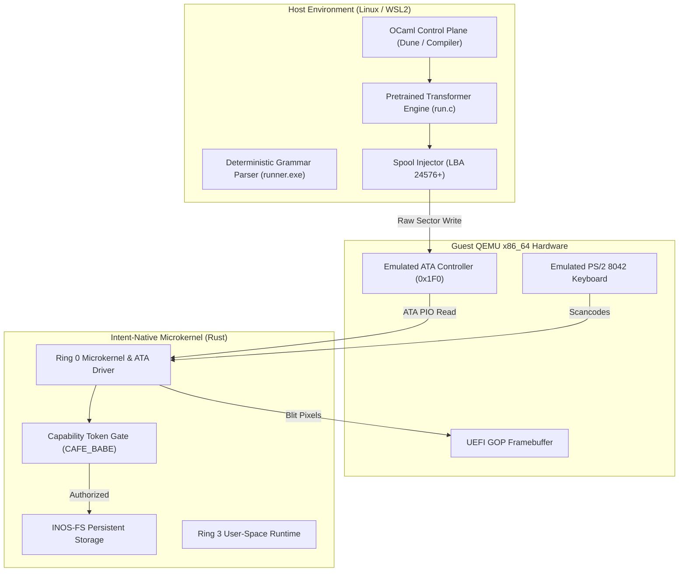

# L007 — Intent-Native OS Capability and Evidence Classification Ledger

**Specification Reference:** Local Intelligence Engineering Backlog v1.0, Task L007  
**Date Established:** 2026-10-09  
**Status:** Active Governance Ledger  

---

## 1. Evidence Hierarchy & Epistemic Tiers

To ensure complete rigor and prevent conflating hosted prototypes or emulated stubs with native operating system capabilities, every system claim in the Intent-Native OS is classified into one of six strictly ordered evidence tiers:

```
[Tier 5: Human Usability Tested]
       ▲
[Tier 4: Hardware-Path Tested (ATA PIO, PS/2 8042, GOP Framebuffer)]
       ▲
[Tier 3: QEMU-Native Demonstrated (Guest Ring 0 / Ring 3)]
       ▲
[Tier 2: Hosted Demonstrated (Linux / WSL Process Boundary)]
       ▲
[Tier 1: Unit & Contract Tested (In-Memory / Algorithm)]
       ▲
[Tier 0: Simulated / Stubbed / Quarantined Hypothesis]
```

### Protocol Invariant: Role of Serial Port Traces
> [!IMPORTANT]
> COM1 UART serial port output strings (e.g., `[G12_PERSISTENCE_VERIFIED]`, `[OK]`, `PASS`) are classified strictly as **supporting diagnostic telemetry**, never as standalone or independent proofs of correctness.  
> Independent verification requires:
> 1. External byte-for-byte disk sector inspection (`xxd`, `dd`, `hexdump`).
> 2. Cryptographic digest comparisons against pre-computed invariants.
> 3. State persistence verified across independent, cold virtual machine power cycles.

---

## 2. Capability Classification Ledger

| Capability / Subsystem | Claim Description | Evidence Tier | Primary Verification Method | Evidence Artifacts |
| :--- | :--- | :---: | :--- | :--- |
| **Microkernel Ring 0 Core** | IDT, GDT, 4-level paging, page fault handling, physical frame allocator | **Tier 3** (QEMU-Native) | Cold UEFI boot under OVMF, page table translation validation | `kernel/src/main.rs`, serial trace |
| **Ring 3 User Mode** | Isolated user-space task execution, iretq privilege transitions | **Tier 3** (QEMU-Native) | Context switch, user page fault trapping | Gate G10 test suite |
| **ATA PIO Disk Storage** | Primary ATA bus PIO data transfer (ports 0x1F0–0x1F7), LBA28 sector reads/writes | **Tier 4** (Hardware-Path) | Direct I/O port instructions, sector buffer validation | `kernel/src/main.rs#L140-L210` |
| **INOS-FS Persistence** | Block allocation, inode creation, directory traversal, cold-boot survival | **Tier 4** (Hardware-Path) | Bit-for-bit file verification after 2 successive QEMU cold reboots | `system_status.log` (131 B), raw disk inspect |
| **PS/2 8042 Input** | Keyboard controller scancode receiving, pacing, decoding, backspace/enter | **Tier 4** (Hardware-Path) | QEMU monitor `sendkey` commands through emulated 8042 chip | Gate G8/G9 interactive logs |
| **GOP Linear Framebuffer** | UEFI Graphics Output Protocol pixel plotting, font rendering, status bar | **Tier 4** (Hardware-Path) | Raw PPM framebuffer dump extracted directly from guest memory | `evidence/g8_desktop.ppm` |
| **Spool Transport Region** | High-LBA reserved sector exchange (LBA 24,576+), header magic `INT_`, CRC check | **Tier 4** (Hardware-Path) | `spool_injector.c` ATA write + kernel parsing at boot | `tools/spool_injector.c`, raw disk inspection |
| **Kernel Capability Gate** | Fail-closed token enforcement (`0xCAFE_BABE_...`), unauthorized write rejection | **Tier 3** (QEMU-Native) | Negative test injecting `cap_token = 0` resulting in `PermissionDenied` | `test_live_intelligence_pipeline.ml` |
| **Local Pretrained Inference** | Autoregressive token generation using genuine LLaMA-2-15M weights | **Tier 2** (Hosted) | Standalone C runner (`run.c`), zero API calls, deterministic greed decoding | `models/pretrained/stories15M.bin` (58 MB) |
| **Deterministic Intent Parser** | Sub-millisecond grammar parsing, concrete directive extraction | **Tier 1** (Unit/Contract) | 100-case held-out benchmark runner (`runner.exe`), 0.0% false authorizations | `benchmarks/results/deterministic_dev_report.md` |
| **Reversible Undo / Snapshots** | LIFO rollback receipt generation, block restoration across cold restart | **Tier 4** (Hardware-Path) | Pre-modification snapshot sector restored and verified across reboot | Gate G9 snapshot receipt & disk diff |
| **A/B Dual-Model Arbitration** | Adversarial planning, proposal critique, and schema reconciliation | **Tier 0** (Simulated / In-Dev) | Gate G1 mock coordination harness; live multi-model execution pending Gate L2 | `test_gate_g1.ml` (Mocked) |
| **Selective Contextual Prompting (SCP)** | Attention suppression & selective context pruning | **Tier 0** (Quarantined) | Experimental research hypothesis; quarantined until Gate L3 preregistration | Backlog Gate L3 specification |
| **Tonic Gating** | Dynamic inference gating based on token certainty thresholds | **Tier 0** (Quarantined) | Experimental research hypothesis; quarantined until Gate L3 preregistration | Backlog Gate L3 specification |

---

## 3. Boundary & Gap Analysis



### Critical Boundaries to Cross in Upcoming Gates:
1. **Host-to-Guest Bridging (Gate L4):** Move the compiled inference runtime from Host WSL into a native Ring 3 guest process (`K4`), eliminating external spool injection for local generation.
2. **Quantized Production Model (Gate L1):** Transition from the 15M TinyStories baseline generator to instruction-tuned 0.5B–3B GGUF quantized models with structured chat templates.
3. **Live Dual-Model Coordination (Gate L2):** Replace simulated A/B coordination with two live model roles operating with isolated context journals.
4. **Controlled Feature Evaluation (Gate L3):** Formally test SCP and tonic-gating hypotheses without importing historical unverified claims.
