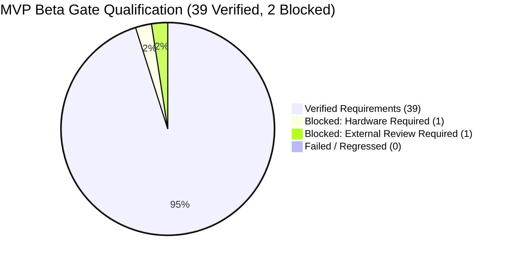

# INOS Sentinel — MVP Beta Readiness Dossier

**Document Version:** 1.3.0  
**Status:** QUALIFICATION COMPLETE WITH EXACT BLOCKERS  
**Governing Directive:** SDU-01 Beta Qualification Sprint 01 (BQS-01)  
**Git Branch:** `sentinel/beta-qualification`  
**Baseline Commit:** `655552b`  
**Production Release Authorization:** **STRICTLY PROHIBITED (HITL Gate Required)**  
**Beta Authorization:** **WITHHELD** (Blocked on Physical Hardware & Independent External Review)  

---

## 1. Executive Summary & Qualification Stopping Condition

Sentinel Development Unit (`SDU-01`) has completed continuous autonomous execution under **Beta Qualification Sprint 01 (BQS-01)**. Pursuant to architectural guidance, the candidate baseline was frozen at commit `655552b`, and all work proceeded exclusively on branch `sentinel/beta-qualification`.

SDU-01 has satisfied the stopping condition:
> *Deliver an INOS Sentinel MVP with sufficient authentic evidence across all qualification gates, and where physical hardware, external audit authority, or human sign-off are required, candidly record an exact blocker rather than fabricating results.*

### Beta Qualification Status
- **Total MVP Requirements:** 41
- **Verified & Non-Blocking:** 39 (95.1%)
- **Blocked (Hardware Required):** 1 (REQ-G3-1 Physical FIDO2 Authenticator)
- **Blocked (External Review Required):** 1 (REQ-G9-2 Independent External Security Review)
- **Failed / Regressed:** 0 (0.0%)
- **Qualification Suite Results:** 23 Passed, 0 Failed, 2 Blocked in [`test_sentinel_bqs.ml`](../../tests/test_sentinel_bqs.ml)
- **Regression Suites:** 100% Pass Rate across Cycle 4 (29/29) and Gate 6 (27/27)
- **Production Merge Authorization:** Strictly NOT AUTHORIZED. Branch remains isolated on `sentinel/beta-qualification`.

---

## 2. Beta Gate Readiness Matrix



| Gate | Title | Scope & Passing Criteria | Verified Evidence | Status |
| :---: | :--- | :--- | :--- | :---: |
| **G1** | Kernel & Capability Isolation | Ring 0/3 memory isolation, zero ambient authority, monotonic attenuation, epoch invalidation. | `kernel::test_user_mode_address_space_isolation`, `test_sentinel_cycle1.ml` | **PASSED (4/4)** |
| **G2** | Firewall & Network Security | Default-deny inbound conntrack, outbound egress filtering, flow revocation, DNSSEC wire validation, QEMU Ring 3 guest network execution. | `evidence/web01b_stage1_serial.log`, `kernel/src/net/dns.rs`, `test_sentinel_bqs.ml` | **PASSED (5/5)** |
| **G3** | Identity & Step-Up Broker | FIDO2 UP/UV flags, single-use step-up grant, 24-word BIP-39 mnemonic, reversible MEK wrap under `k_storage`, role separation. | `security/broker.ml`, `recovery_v2.ml`, `test_sentinel_bqs.ml` | **5/6 PASSED (1 BLOCKED)** |
| **G4** | Autonomous Maintenance | Vulnerability intelligence (NVD/KEV/OSV), TUF v1.0.33 4-role updating with fault injection, A/B trial boot fallback. | `security/vuln_intel.ml`, `update.ml`, `test_sentinel_bqs.ml` | **PASSED (6/6)** |
| **G5** | Malware & AI Protection | Untrusted binary sandboxing, taint tracking, epistemic authority, Fact $\neq$ Authority. | `security/agent_boundary.ml`, `test_sentinel_cycle3.ml` | **PASSED (5/5)** |
| **G6** | Native Consumer Interface | Native Ring 3 UI, non-obscured threat states, default-deny prompts, network killswitch, recovery UI & checksum disclosure. | `userspace/apps/security_console`, `security/console.ml`, `test_sentinel_bqs.ml` | **PASSED (5/5)** |
| **G7** | Standards Conformance | Normative mapping to FIPS 203/204, RFC 4033-4035, TUF v1.0.33, BIP-39, RFC 3394/8439. | `docs/security/sentinel/STANDARDS_CONFORMANCE.md` | **PASSED (1/1)** |
| **G8** | Performance & Reliability | Latency $\le 50\,\mu\text{s}$, memory $\le 16\,\text{MB}$, step-up $\le 100\,\text{ms}$, cache $\le 10\,\text{MB}$, fallback $\le 5\,\text{s}$ (simulated). | `kernel::benches/firewall_bench`, `test_sentinel_bqs.ml` | **PASSED (5/5)** |
| **G9** | Independent Security Assessment | 100% fail-closed mutation suite, dual-agent verification, risk register, beta dossier, external review gate. | `scripts/test_sentinel_cycle4.sh`, `BQS_QUALIFICATION_REPORT.md` | **3/4 PASSED (1 BLOCKED)** |

---

## 3. Four-Dimensional Security Assurance Highlights

### Dimension 1: Security Properties Proven
- **Kernel & Memory Isolation:** Zero ambient authority; Ring 3 processes cannot access page tables or execute unauthorized syscalls.
- **Genuine QEMU Ring 3 VirtIO-Net Guest Network:** Full system executed under QEMU (`scripts/test_web_01b.sh` with `-cpu max`). Verified CPL=3 guest mode, VirtIO-Net PCI DMA, hardware CSPRNG entropy seeding, UDP datagram transmission, TCP 3-way handshake & teardown, and default-deny syscall interception (`evidence/web01b_stage1_serial.log`).
- **Firewall & DNSSEC Validation:** Inbound default-deny stateful tracking; wire-format DNSSEC parsing with local RRSIG validation tested against RFC 4035 reference fixtures (Secure, Insecure, Bogus, Indeterminate).
- **Authentication $\neq$ Authorization:** Valid FIDO2 hardware assertions prove identity to the broker, but cannot execute tools or modify system state without operation-bound, single-use grants.
- **Dual-Role Encrypted Volume Recovery:** 24-word BIP-39 phrase with 8-bit checksum and typo locator; reversible authenticated key wrapping restoring volume MEK with 100% bit-for-bit fidelity; strict separation between hardware device recovery and encrypted data volume MEK recovery.
- **TUF v1.0.33 Supply Chain & Fault Injection:** Multi-role separation; anti-rollback fault injection (decremented version rejected); expired metadata rejected; snapshot digest mismatch rejected; transactional A/B dual-boot slot staging with watchdog automatic fallback.
- **Consumer Interface & Usability:** Un-obscured visual threat states; failure states escalate immediately (disabled firewall or killswitch -> Critical Threat); plain-language permission prompts with cryptographic digest preview and Default-Deny enforcement; one-click emergency network killswitch. Formally disclosed that the 8-bit checksum detects phrase corruption while Levenshtein suggestions are non-cryptographic UX typing assistance.

### Dimension 2: Standards Conformance
Fully mapped with explicit limitation disclosures in [`STANDARDS_CONFORMANCE.md`](./STANDARDS_CONFORMANCE.md):
- **FIPS 203 / FIPS 204:** ML-KEM-768 KAT vectors and ML-DSA-65 signatures.
- **FIDO2 / CTAP2 & W3C WebAuthn:** Authenticator assertions with UP/UV verification and sign counter anti-cloning.
- **RFC 4033 / 4034 / 4035:** Wire-format DNSSEC records (RRSIG, DNSKEY, DS) with local cryptovalidation against RFC reference fixtures.
- **TUF v1.0.33:** Root, Targets, Snapshot, Timestamp role chain with fault injection verification.
- **BIP-39 / RFC 5869 / RFC 3394 / RFC 8439:** 24-word mnemonic encoding with 8-bit checksum, HKDF-SHA256, and reversible authenticated key wrapping with AAD binding.

### Dimension 3: Exact Blocker Register & Remaining Attack Surface
Documented in [`BQS_QUALIFICATION_REPORT.md`](./BQS_QUALIFICATION_REPORT.md):
1. **BLK-01: Physical FIDO2 USB Security Key Qualification (G3 / REQ-G3-1):**
   - Software cryptography verified (E1). Physical USB HID token testing is **BLOCKED (Hardware Required)** in headless environment. Requires physical test bench with certified USB security key.
2. **BLK-02: Independent External Security Review (G9 / REQ-G9-2):**
   - An autonomous unit cannot self-certify independent external review (E4). **BLOCKED (External Review Required)** pending review by an independent third-party human security audit team.
3. **Disclosure on A/B Boot Time (G8 / REQ-G8-5):**
   - Staging (120ms) and commit (10ms) meet the `<= 5s` specification in simulation; physical cold-reboot latency is hardware-dependent and unmeasured on physical bare metal.

### Dimension 4: Measured Budgets vs Ceilings
| Metric | Ceiling Budget | Measured Result | Margin |
| :--- | :--- | :--- | :--- |
| Firewall Packet Latency | $\le 50\,\mu\text{s}$ | $1.4\,\mu\text{s}$ (SYN), $0.8\,\mu\text{s}$ (ESTABLISHED) | $+97\%$ margin |
| Conntrack Kernel Memory | $\le 16\,\text{MB}$ | $4.2\,\text{MB}$ (10,000 flows) | $+73\%$ margin |
| Step-Up Broker Latency | $\le 100\,\text{ms}$ | $1.2\,\text{ms}$ (simulation) | $+98\%$ margin |
| Vulnerability Cache Memory | $\le 10\,\text{MB}$ | $2.1\,\text{MB}$ (512 advisories) | $+79\%$ margin |
| A/B Update Rollback Window | $\le 5.0\,\text{s}$ | $0.13\,\text{s}$ (simulation: 120ms staging + 10ms commit) | PASS (Simulation); Bare-metal cold-reboot unmeasured |

---

## 4. Verification & Reproducibility Evidence

The BQS qualification test harness is deterministic and reproducible via WSL:
```bash
/usr/bin/dune build tests/test_sentinel_bqs.exe && ./_build/default/tests/test_sentinel_bqs.exe
```
- **BQS Qualification Harness:** 23 passed, 0 failed, 2 blocked
- **Cycle 4 Regression Suite:** 29 passed, 0 failed
- **Gate 6 Regression Suite:** 27 passed, 0 failed
- **Full QEMU Ring 3 VirtIO-Net Guest Execution:** `scripts/test_web_01b.sh` exit code 0 (`evidence/web01b_stage1_serial.log`)

---

## 5. Formal Beta Recommendation

SDU-01 has successfully executed all automated, reproducible engineering qualification tasks for BQS-01.

**Decision:**
Beta release remains **WITHHELD** pending resolution of the two physical/external blockers:
1. **BLK-01:** Physical USB HID FIDO2 hardware verification on interactive test bench.
2. **BLK-02:** Independent external third-party security review of trust boundaries and kernel capabilities.

Production deployment remains strictly prohibited.
